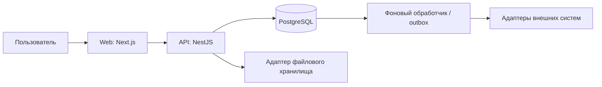

# Архитектура Fleet SaaS

Это проектное предложение новой сборки. Цель MVP — дать диспетчеру завести рейс,
назначить машину и водителя, рассчитать плановые затраты и затем сравнить с фактом.

## Компоненты

Один репозиторий, модульный монолит API. Отдельный процесс фоновых задач добавляется
при появлении импорта/экспорта. Очередь и Redis не обязательны для первого MVP.
Интерфейс вызывает API; бизнес-правила и авторизация живут на сервере. Общий пакет
контрактов хранит схемы запросов/ответов, но не открывает серверные секреты браузеру.

| Модуль | Данные и ответственность |
|---|---|
| Identity/Tenancy | Организации, пользователи, членство и роли |
| Fleet | Машины, водители, доступность и архивирование |
| Trips | Маршрутные пункты, назначение, переходы статусов |
| Costing | Версионированные тарифы, снимки входов и детализация расчёта |
| Expenses | Фактические затраты и подтверждающие документы |
| Reporting | План/факт, фильтры, экспорт с теми же правами |
| Audit | Кто, когда, какую сущность изменил и почему |
| Integrations | Адаптеры поставщиков, идемпотентность и повторные попытки |

## Модель данных

`organizations(id, name)`; `users(id, external_subject)`;
`memberships(tenant_id, user_id, role)` с уникальной парой tenant/user.
Все бизнес-таблицы содержат `tenant_id`, `id`, `created_at`, `updated_at`.
В `vehicles` и `drivers` нужна уникальность `(tenant_id, id)`, а в `trips`
ссылки `(tenant_id, vehicle_id)` и `(tenant_id, driver_id)` должны ссылаться
на соответствующую составную пару. Это исключает межорганизационные назначения.

`trips`: машина, водитель, плановые/фактические времена, статус, `version`.
`tariff_versions`: валюта, единицы, ставки и дата действия.
`cost_estimates`: trip, tariff_version, calculation_version, snapshot JSON,
детализация и итог. `expenses`: категория, decimal amount, currency, дата,
источник, ссылка на документ. `audit_events`: actor, tenant, entity, действие,
разрешённый набор изменений и correlation_id.

Деньги: PostgreSQL numeric либо minor units с явным масштабом; API передаёт
десятичные значения строками. Один расчёт — одна валюта. Конверсия требует
отдельного снимка курса и даты; в MVP её нет.

## Изоляция и роли

Выбранный tenant сверяется с membership аутентифицированного пользователя.
Tenant-фильтр обязателен в репозиториях, связях, фоновых заданиях и выгрузках.
RLS можно добавить вторым уровнем защиты; она требует корректной роли БД,
транзакционного tenant-контекста и проверки очистки контекста при повторном
использовании соединений. У владельца таблиц может быть обход RLS — тестировать
через реальную роль приложения. RLS не заменяет проверку бизнес-ролей.

Предлагаемая матрица: owner — пользователи и настройки; dispatcher — рейсы и
назначения; accountant — затраты и отчёты; viewer — только разрешённое чтение.
Видимость финансов у dispatcher/viewer определить до разработки экранов.
Отсутствие решения не означает открытый доступ к финансовым данным.

## API и согласованность

Пример пространства: `/api/v1/vehicles`, `/drivers`, `/trips`,
`/trips/{id}/estimates`, `/trips/{id}/expenses`.
Списки используют ограничение размера страницы и стабильную сортировку.
Изменения рейса проверяют version для защиты от потерянных обновлений.
Создание расходов принимает ключ идемпотентности, уникальный в пределах tenant
и операции; повтор с другим payload возвращает конфликт.

Статусы: draft → planned → in_progress → completed; отмена разрешена из draft
и planned. Изменение завершённого рейса оформляется отдельной коррекцией.
Назначение проверяет доступность ресурсов в одной транзакции с изменением.
Расчёт тарифа сохраняет снимок ставок: новая версия тарифа не меняет историю.

## Надёжность и выпуск

Запись бизнес-события и outbox — в одной транзакции. Потребитель повторяемый:
повторный event не создаёт вторую затрату. Не заявлять exactly-once delivery.
Импорт файлов ограничивает размер, тип, tenant и права; выгрузки имеют срок
жизни и проверку владельца. Логи не содержат сырые токены и персональные поля.

Начальные метрики: ошибки/задержка API, возраст фоновых задач, провалы расчётов,
отказы доступа и состояние резервного копирования. Цели задержек, RPO и RTO
согласовать под нагрузку и бюджет. Проверить восстановление, а не только создание
бэкапа. Миграции развивать по схеме expand → backfill → switch → contract.
