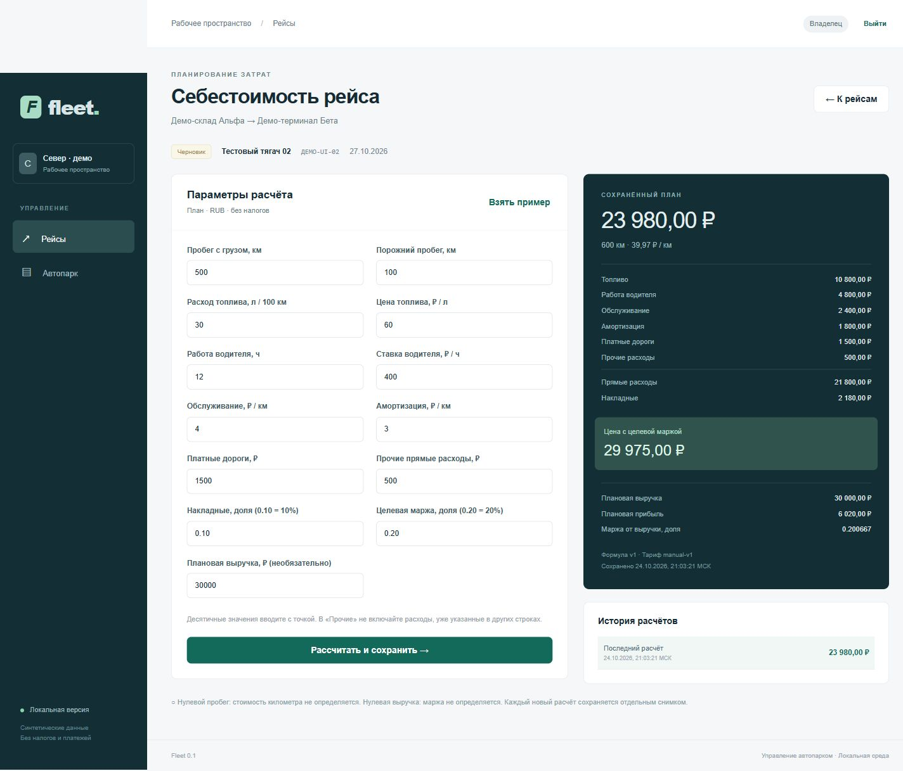

# Проверка первой вертикали — 24 октября 2026

Исторический отчёт первого этапа. Актуальное расширение проверено в
[VERIFICATION_STAGE_2.md](VERIFICATION_STAGE_2.md).

Результат: локальное приложение запущено на http://localhost:3000. Интерфейс Next.js,
API NestJS и настоящая PostgreSQL. Публичных сервисов не создано.

## Проверенное окружение

Windows, Node.js 24.18.0, npm 11.16.0, Python 3.12.10. Установлены Next.js 16.4.3,
NestJS 11.2.8, TypeScript 5.9.3, pg 8.23.1, decimal.js 10.6.0, zod 4.6.7.
PostgreSQL 17.11 запущена из work/pgsql без службы Windows. Архив получен с
[официального сервера EDB](https://get.enterprisedb.com/postgresql/postgresql-17.11-3-windows-x64-binaries.zip).
Локальный SHA-256 скачанного архива (для воспроизводимости, не независимая подпись):
4B8DB0930C38F6EF845DB919551DEDDA3B6B845AEB0927B3D79A6E8E9E4537CF.

## Выполненные проверки

| Проверка | Результат |
|---|---|
| Исходный check_starter.py --integrity до изменений | PASS |
| Шесть проектных SKILL.md | Найдены и прочитаны |
| npm run typecheck (включая тесты и скрипт БД) | PASS |
| npm run lint | PASS |
| npm test | 8/8 |
| npm run test:integration | 14/14 (13 сценариев + общий тест), настоящая PostgreSQL |
| npm run build | PASS, API и производственная сборка Next.js |
| npm audit после обновления зависимостей | 0 известных уязвимостей |
| npm audit --omit=dev | 0 известных уязвимостей |
| python scripts/check_starter.py после изменений | PASS |
| python -m unittest discover -s tests -v | 12/12 |
| Эталон Python и TypeScript | Полное совпадение результата examples/trip-cost.json |
| Миграция новой БД и повтор той же миграции | PASS, без повторного применения |
| scripts/stop-local.ps1 → scripts/start-local.ps1 | PASS; сессия и записи сохранились |

Эталон: пробег 600 км, топливо 180 л, Total 23980.00 RUB, Cost/km 39.97,
Target price 29975.00, Profit 6020.00, Actual margin 0.200667.

Интеграционные проверки покрывают: вход и HttpOnly cookie; отсутствие сессии;
чужой Origin; чужие GET/PATCH машин и рейсов; tenant-фильтры списков; запрет
чужих расчётов; составной FK между рейсом и машиной; роли viewer/dispatcher/accountant;
сохранение входов, версии, автора и numeric-итога; конкурентные повторы создания
и расчёта; конфликт одного ключа с разными данными; устаревшие версии;
неизвестные поля, лимиты пагинации, неверные числа; отзыв сессии при выходе.
Тестовая схема удалена после выполнения, демонстрационные записи не затрагивались.

## Браузерная приёмка

Через интерфейс выполнены:

1. Вход owner@sever.demo.
2. Создание машины «Тестовый тягач 02», номер ДЕМО-UI-02.
3. Создание рейса «Демо-склад Альфа → Демо-терминал Бета» на 27.10.2026.
4. Подстановка эталона и сохранение результата 23980.00 RUB.
5. Маржа 1 отклонена, ошибка связана с полем, остальные значения сохранены.
6. Полный перезапуск локальных процессов и базы; повторное открытие того же снимка.
7. Вход owner@vector.demo: только машина и рейс организации «Вектор».
8. Возврат к сохранённому расчёту «Север».

Проверены ширины 390 и 1440 пикселей. На узком экране формы в одну колонку,
таблицы прокручиваются внутри контейнера. Временный размер браузера сброшен.
Ошибок/предупреждений в консоли браузера при финальной проверке нет.

Во время приёмки устранено ложное предупреждение об изменённых параметрах:
сравнение JSON по порядку ключей заменено сравнением значений полей.
Проверка готовности локального запуска использует loopback без системного proxy.

## Границы результата

Это локальная основа, не production-релиз. Ограничения, тестовые входы,
команды запуска/остановки и миграции перечислены в [RUNBOOK.md](RUNBOOK.md).
CI-файл подготовлен, но запуск на GitHub не выполнялся. Папка изначально не
содержала .git, поэтому commit, ветка и PR не создавались. Нагрузочные тесты,
аудит production-безопасности и восстановление из резервной копии не выполнялись.
Исходные архитектурные документы, навыки и эталонный калькулятор сохранены.

Следующий ограниченный этап: согласовать жизненный цикл рейса и водителей,
затем добавить назначение, изменение статусов и фактические расходы с план/факт.
