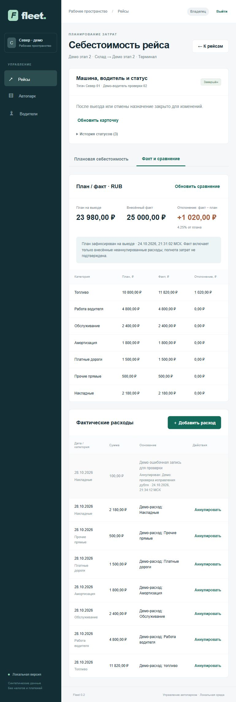

# Проверка второго этапа — 24 октября 2026

Локальное приложение запущено на http://localhost:3000. Добавлены смена машины
в карточке себестоимости, водители, назначения, жизненный цикл рейса, фактические
расходы и сравнение с планом. [Правила и границы](SECOND_SLICE.md),
[запуск и восстановление](RUNBOOK.md), [контракт API](API.md).

## Автоматические проверки

| Проверка | Результат |
|---|---|
| npm run typecheck | PASS, включая тесты и скрипты |
| npm run lint | PASS |
| npm test | 15/15 |
| npm run test:integration | 36/36, настоящие NestJS HTTP и PostgreSQL |
| npm run build | PASS, shared + API + производственная сборка Next.js |
| python scripts/check_starter.py | PASS |
| python -m unittest discover -s tests -v | 12/12 |
| Эталон TypeScript / исходный Python | Полное совпадение, себестоимость 23980.00 RUB |
| Миграция существующей БД и повторный запуск мигратора | PASS |
| Полный перезапуск приложения и PostgreSQL | PASS, сессия и данные сохранились |

Интеграционные тесты используют отдельные временные схемы. Проверены чужие ID
водителей, назначений, статусов, расходов, аннулирования и отчётов; фильтры списков,
роль на прямых HTTP-запросах и составные FK. Финансы недоступны dispatcher/viewer.
RLS не включена: изоляцию обеспечивают серверные tenant-фильтры и связи базы.

Проверены устаревшие версии, неактивный водитель, запрещённые переходы, обязательная
причина отмены, конкурирующее бронирование одного водителя/автомобиля, повторные
расходы и аннулирование без двойного денежного эффекта. Суммы считаются десятичной
арифметикой. Нет факта или записи категории — нет выдуманного нулевого расхода.

Обновление схемы проверено на данных первого этапа: старые расчёты сохранены,
неизвестные исторические назначения остаются null. При смене машины старый план
сохраняется в истории, для сравнения нужен план текущего назначения. На выезде
его ID фиксируется; поздние расходы не переписывают план. Старт без подходящего
плана сохраняет отсутствие плана, а не подбирает устаревший снимок.

## Приёмка в браузере

На отдельном синтетическом рейсе «Демо этап 2 · Склад → Демо этап 2 · Терминал»:

1. Создан водитель «Демо-водитель проверки 02», DEMO-UI-02.
2. В карточке себестоимости машина заменена на «Тягач Север 01», назначен водитель.
3. Сохранён план 23980.00 RUB. Выполнены переходы «Запланирован → В пути → Завершён».
4. Проверен запрет расхода с тремя знаками после точки; введённые поля сохранились.
5. Внесены семь категорий расходов: итог 25000.00 RUB, отклонение +1020.00 / +4.25%.
6. Дополнительная ошибочная запись 100.00 RUB аннулирована с причиной. Исходная
   запись осталась в истории; итог вернулся к 25000.00 RUB.
7. После полной остановки/запуска снова открыта карточка: статус, три перехода,
   назначение, замороженный план, расходы и аннулирование сохранились.

Проверены ширины 390 и 1440: нет горизонтального выхода всей страницы, формы и
итоги адаптируются, широкие таблицы имеют собственную прокрутку. Временный размер
браузера сброшен. В финальной проверке консоль не содержит ошибок/предупреждений.

## Сохранность и ограничения

До миграции создан локальный custom-дамп
work/backups/fleet-2026-10-24T18-26-29.325Z.dump. Ранее введённые пользователем
машины, рейсы и расчёты не менялись для браузерной проверки. Соседний проект
logistic-mvp-0.1.0-source не изменялся. Исходный Python-калькулятор сохранён.

Это локальная версия. Один planned/in_progress рейс резервирует машину и водителя
до закрытия независимо от даты; календаря интервалов пока нет. Ставки ручные,
завершённые/отменённые рейсы не переоткрываются. Факт отражает только внесённые
расходы, полнота не подтверждается; чеков, фактической выручки и налогового учёта нет.

CI использует расширенные команды тестов, но удалённый запуск не выполнялся.
В папке нет Git-репозитория: commit/PR не создавались. Восстановление из дампа,
нагрузочный тест и production-аудит в этот этап не входили.
